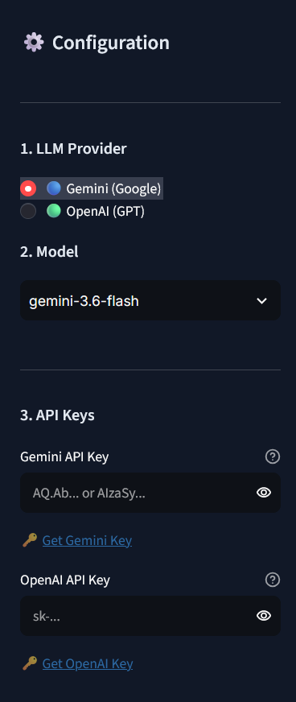
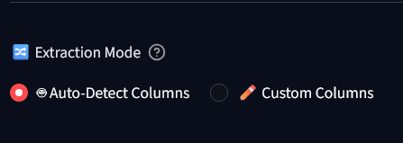
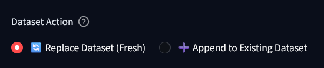
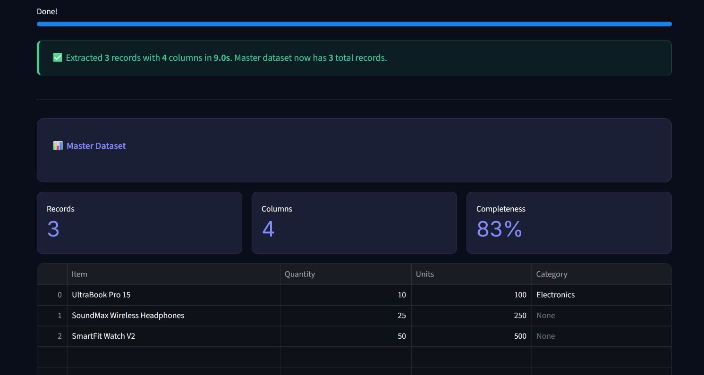
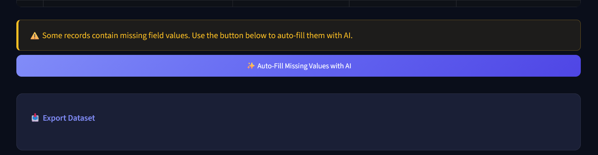
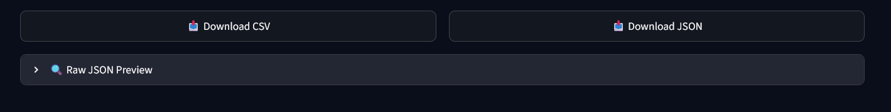

# Prompt2Table

Turn messy unstructured text, bullet points, or raw notes into clean, structured tables (CSV / JSON) using LLMs.

---

## 🛠️ Key Features & Application Workflow

### 1. Multi-LLM Configuration & API Management
Configure your preferred AI provider (Google Gemini or OpenAI), select models dynamically, and manage your API keys securely via the sidebar menu.

<div align="center">
  
</div>

---

### 2. Flexible Extraction Modes
Choose between two extraction strategies:
* **Auto-Detect Columns:** Automatically infers the optimal schema and header names directly from your unstructured text.
* **Custom Columns:** Define explicit target column names to enforce a fixed table structure.

<div align="center">
  
</div>

---

### 3. Smart Dataset Actions
Manage how extracted records interact with active data:
* **Replace Dataset (Fresh):** Overwrites current results to build a brand new table.
* **Append to Existing Dataset:** Merges newly extracted records seamlessly into your master dataset.

<div align="center">
  
</div>

---

### 4. One-Click Conversion Engine
Click **Convert to Dataset** to send raw input to the LLM and instantly receive formatted, structured data.

<div align="center">
  
</div>

---

### 5. Interactive Data Table & Summary
Preview extracted records in an interactive table complete with real-time statistics on row counts, column types, and missing field indicators.

<div align="center">
  
</div>

---

### 6. In-Place AI Missing Value Imputation
Detect missing values or placeholder symbols (`—`, `null`) and use contextual LLM reasoning to fill in blank cells without altering row order or existing data.

<div align="center">
  
</div>

---

### 7. Clean Data Export
Download processed datasets instantly as clean **CSV** or **JSON** files with stripped unit characters and standardized data types.

<div align="center">
  
</div>

---

## 🚀 Quick Start

```bash
# 1. Clone the repository
git clone [https://github.com/sahilbhalke04/Prompt2Table.git](https://github.com/sahilbhalke04/Prompt2Table.git)
cd Prompt2Table

# 2. Set up virtual environment
python -m venv .venv
.venv\Scripts\activate      # On Windows
# source .venv/bin/activate # On Mac/Linux

# 3. Install dependencies
pip install -r requirements.txt

# 4. Run the app
streamlit run app.py


Prompt2Table/
├── docs/
│   └── screenshots/       # Application workflow preview images
├── auto_extractor.py      # Auto-detects columns from unstructured text
├── custom_extractor.py    # Extracts user-defined columns
├── enricher.py            # AI-powered missing value imputation (Auto-Fill)
├── exporter.py            # Data cleaning, null handling, & file downloads
├── app.py                 # Streamlit UI
└── requirements.txt       # Project dependencies


👥 Contributors

Sahil Bhalke — Architecture, Auto Extraction & UI
Manasi Ghadge — Custom Extraction, Data Cleaning & Exporter